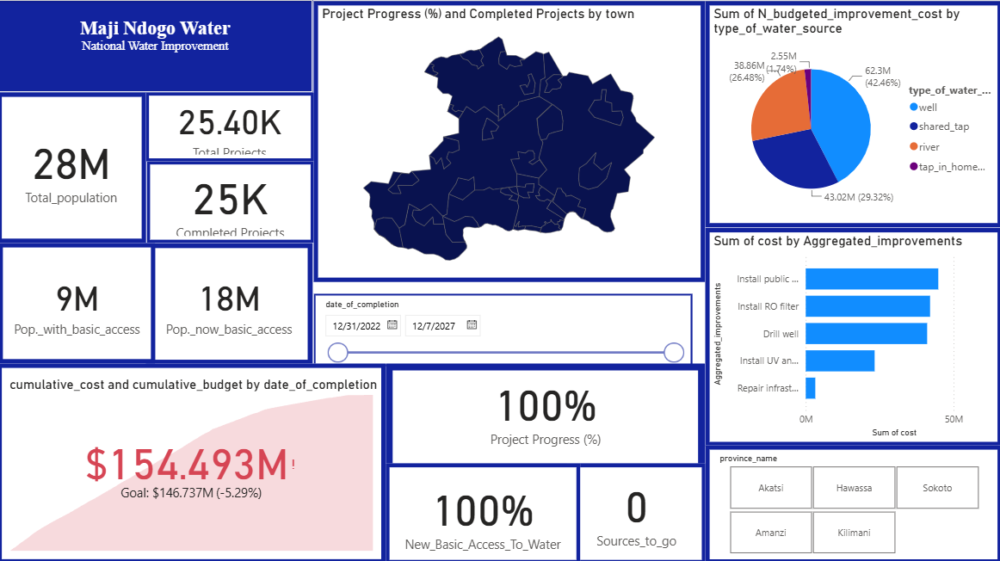

# Water-accessibility
An analysis to access a waster accessibility and the implementation of projects to make it accessible to more people.

# Maji Ndogo Water Access Analysis

An end-to-end analysis of water access in the fictional country of Maji Ndogo,
using **MySQL** for data analysis and **Power BI** for an interactive dashboard
showing the impact of water infrastructure projects.

## Live Dashboard
[

🔗 [View the dashboard](https://app.powerbi.com/view?r=eyJrIjoiNDAxYzgxZjMtYjEyYS00OWQ4LWEwNTYtYmRiZWYzMjE5ZWU4IiwidCI6IjVlMDA3YjZjLTI1OGItNGZkZS1hZGMxLThiZjhhMTM1ODg1ZCIsImMiOjh9) 

## Key Findings
- **Population reached:** Of Maji Ndogo's ~28M people, about **9M had access to
  water before the assessment and installations**. After installation, this rose
  to about **18M**, doubling access.
- **Project scale:** About **25.4K projects** were identified, with **25K
  completed** across **5 provinces** (2022 to 2027).
- **Most cost-effective option:** Installing **home taps** was the least costly
  intervention, though it reached about **4M people**.
- **Biggest reach:** **Public (shared) taps** were the most costly to install
  but reached about **9M people**, representing **61%** of those gaining access.

## Tools Used
- **MySQL:** data exploration, cleaning, joins and aggregation
- **Power BI:** dashboard design and visualization (DAX, data modeling)

## Data
The dataset (`Estimates-on-the-use-of-water-(2020)-a-3712.csv`) was provided as part of the ALX Data Analytics
programme. It covers water sources, visits, water quality, well pollution tests,
locations and employees in Maji Ndogo, plus a global water access table.
The data is not included in this repository.

## SQL Analysis
| File | Purpose |
|------|---------|
| `[md_water_services.sql](https://1drv.ms/u/c/c1a31aee64bd8402/IQDjq58KLo16T6lauSjEsOiaAWUky3HXvAqw2CEbNPE-kU4?e=xHQP0x)` | Building data, cleaning and further analysis. Explores tables and relationships |
| `[Madji Ndogo Project Visualization.sql](Madji Ndogo Project Visualization.sql)` | Queries used to build the dashboard metrics |

## Repository Structure
```
├── README.md
├── sql/
├── dashboard/
│   └── Madji_Ndogo_Dashboard.pbix
└── images/
    └── dashboard_preview.png
```

## What I Learned
This was my first hands-on project in Power BI, and it taught me how to turn raw data, query to get
raw SQL results and turn it into a story people can act on.

- **Building a custom map:** I learned how to set up a map visual to show
  water access across Maji Ndogo's provinces, so differences between
  locations are visible at a glance instead of buried in a table.
- **Creating measures:** I learned how to write measures (DAX) to calculate
  key figures such as people with access, project counts and costs, rather
  than relying only on the raw columns.
- **Choosing the right visual:** I practised matching each insight to the
  clearest chart, for example comparing the cost and reach of different
  water sources, and showing before-and-after access.
- **Data storytelling:** I learned to structure the dashboard so it moves from
  the big picture (population and access) to the details (projects, costs and
  infrastructure types), guiding the viewer to the conclusion.
- **Working beyond the guide:** The guide explained what to build, so I had to apply knowledge and skills learned throughout the course to research and solve problems myself.

## Acknowledgements
This project was completed as part of **Data Analytics with ALX**. The course
provided the dataset, a guide and example queries. 

## Contact
Lydia Kumah· http://www.linkedin.com/in/lydia-kumah ·Lydiapearlkumah@gmail.com
